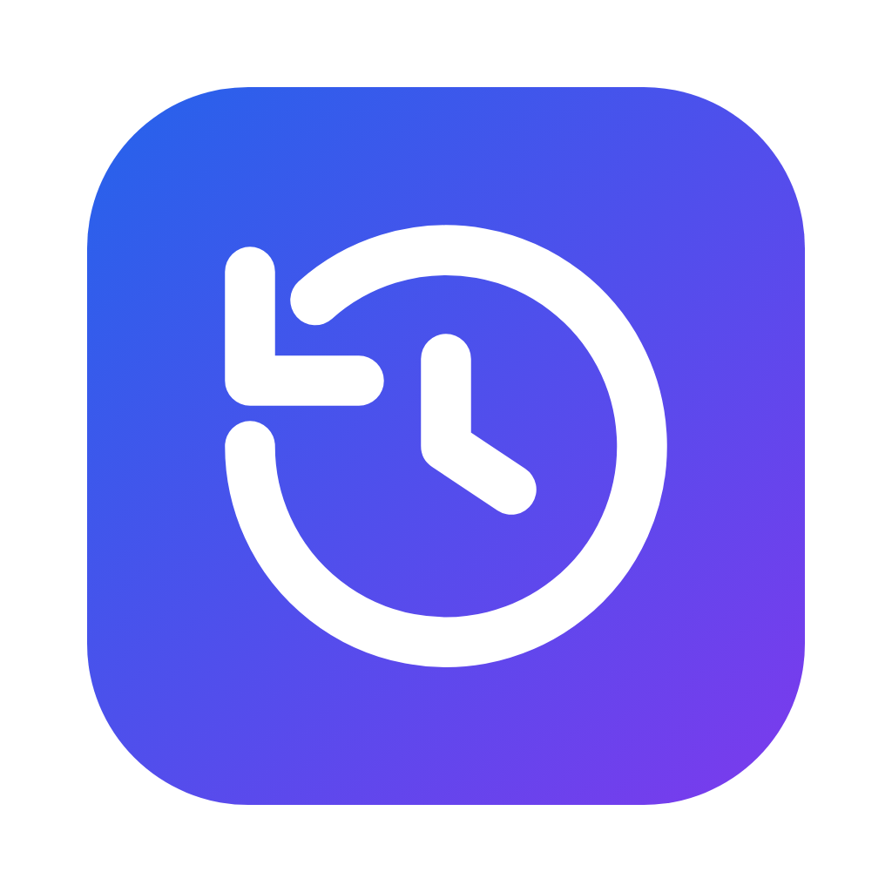
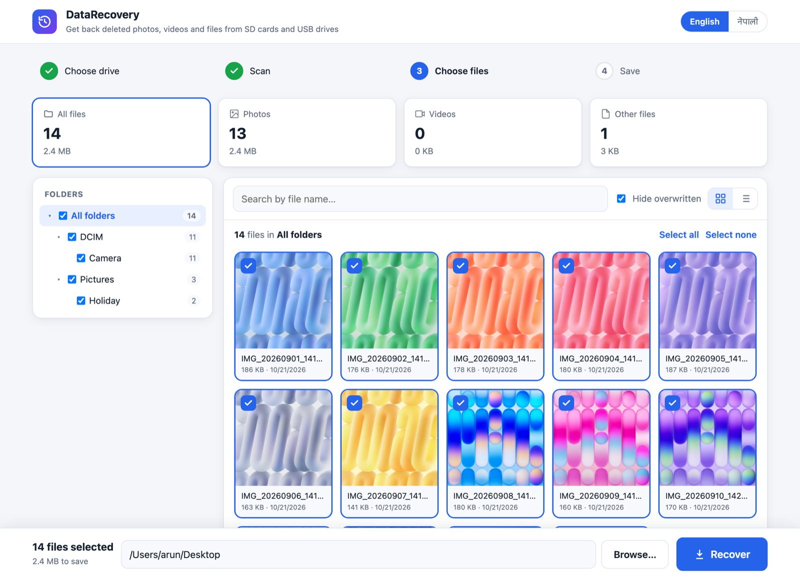
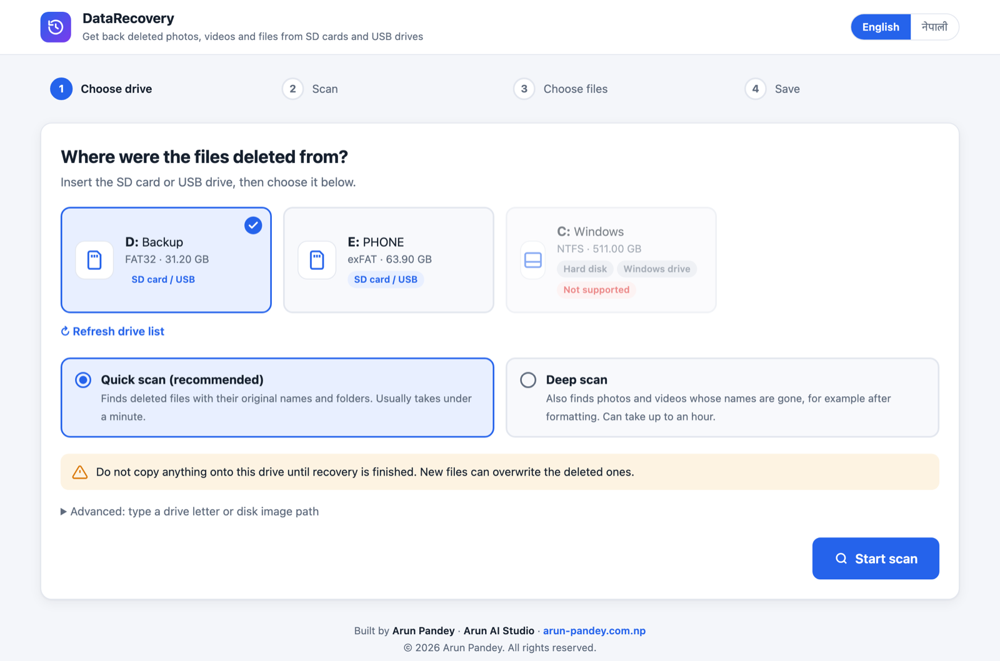
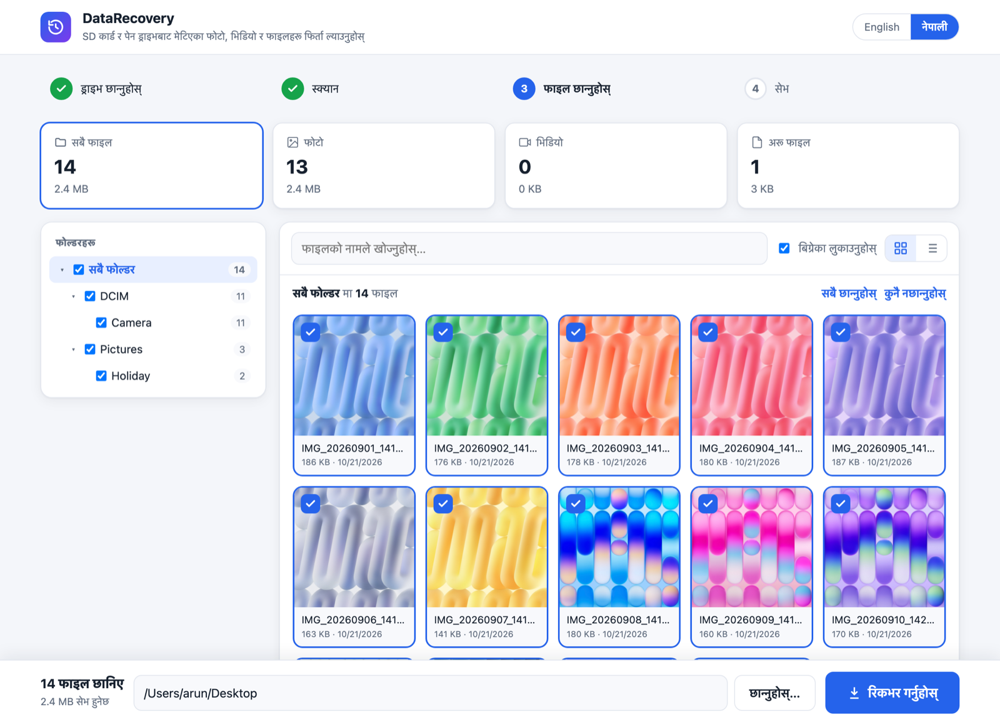

<p align="center">
  
</p>

<h1 align="center">DataRecovery</h1>

<p align="center">
  Get back deleted photos, videos and files from SD cards, USB drives and camera cards,<br>
  with their <b>original names, folders and dates</b>.
</p>

<p align="center">
  <a href="https://github.com/00Arun/DataRecovery/raw/main/dist/DataRecovery-Setup.exe"></a>
  &nbsp;
  <a href="https://github.com/00Arun/DataRecovery/raw/main/dist/DataRecovery.dmg"></a>
</p>

<p align="center">
  Windows 10/11 (64-bit) &nbsp;·&nbsp; macOS 11+ (Apple Silicon and Intel) &nbsp;·&nbsp; English and नेपाली
</p>

<p align="center">
  
</p>

## Why DataRecovery

- **Keeps names and folders.** Deleted files come back as `DCIM/Camera/IMG_20260918_141122.jpg`, not `f12345678.jpg`, with their original dates.
- **See before you recover.** Deleted photos show as thumbnails; click one for a full preview.
- **Deep scan.** Finds photos and videos even after their names are gone, for example after formatting (JPG, PNG, HEIC, MP4, MOV, 3GP).
- **Safe.** It only reads the card. It never writes to it, and it will not save recovered files onto the card you are recovering from.
- **Simple.** Four steps: choose drive, scan, choose files, save. In English or Nepali.

## Download and install

### Windows

1. Download **[DataRecovery-Setup.exe](https://github.com/00Arun/DataRecovery/raw/main/dist/DataRecovery-Setup.exe)** and open it.
2. If Windows shows *"Windows protected your PC"*, click **More info → Run anyway**. (The app is not code-signed yet.)
3. Click **Install**. DataRecovery is added to the Start menu and the desktop.
4. When you open DataRecovery, click **Yes** when Windows asks for permission. It needs this to read the card directly.

To uninstall: **Settings → Apps → DataRecovery → Uninstall**.

### macOS

1. Download **[DataRecovery.dmg](https://github.com/00Arun/DataRecovery/raw/main/dist/DataRecovery.dmg)** and open it.
2. Drag **DataRecovery** into **Applications**.
3. The first time, **right-click DataRecovery → Open → Open**. (The app is not notarized by Apple yet.) If there is no Open button, go to **System Settings → Privacy & Security** and click **Open Anyway**.
4. When you start a scan, enter your Mac password. macOS asks for it before any app can read a card directly.

To uninstall: drag DataRecovery from Applications to the Trash.

Step-by-step guides in Nepali: [Windows](README.txt) · [macOS](README-mac.txt)

## How to use

<p align="center">
  
</p>

1. **Insert the card** and do not copy anything onto it. New files can overwrite the deleted ones.
2. **Choose the drive** and a scan type:
   - **Quick scan (recommended):** finds deleted files with their names and folders, usually in under a minute.
   - **Deep scan:** also finds photos and videos whose names are gone. On a 128 GB card this can take 30 to 60 minutes.
3. **Choose files.** Browse by folder, filter photos, videos or other files, search by name, and preview photos.
   - No mark: intact, should recover fully
   - Yellow: partly overwritten, may be damaged
   - Red: overwritten, probably unusable (hidden by default)
4. **Save** to a folder on another drive (the Desktop is suggested) and click **Recover**. Then click **Open folder**.

Recovered files are saved as:

```
<your folder>/Recovered_<card name>_<date time>/<original folders>/<original file names>
  _Found/Photos, _Found/Videos     found by deep scan, names were lost
  _LostFolders/folder_<number>     names found, but the original folder is unknown
```

<p align="center">
  
  <br><sub>Switch between English and नेपाली at any time.</sub>
</p>

## Supported drives

| | |
|---|---|
| File systems | FAT32, FAT16, exFAT (almost all SD cards, USB drives and camera cards) |
| Not supported | NTFS, APFS, HFS+ |
| Deep scan finds | JPG, PNG, HEIC, MP4, MOV, 3GP |

Good to know:

- Recover as soon as possible. Every new file written to the card can overwrite deleted ones.
- On FAT32, the first letter of a deleted folder with a short name can be lost (for example `IMAGES` comes back as `_MAGES`). Long names are restored in full.
- After a format, names are gone. Use **Deep scan**.

## Build from source

On a Mac, with Go 1.22+, the Wails CLI and NSIS:

```sh
go install github.com/wailsapp/wails/v2/cmd/wails@v2.10.1
brew install makensis
scripts/build-installers.sh      # writes dist/DataRecovery.dmg and dist/DataRecovery-Setup.exe
```

Command-line mode, for scripting:

```sh
DataRecovery -src /dev/rdisk4s1 -out ~/Desktop/Recovered [-deep] [-only /DCIM/Camera]
```

Tests (`DATARECOVERY_TEST_IMAGE` is a FAT or exFAT image containing a deleted folder):

```sh
DATARECOVERY_TEST_IMAGE=card.img go test ./...
```

<details>
<summary>Project layout</summary>

| Path | What it is |
|---|---|
| `device.go`, `volume.go`, `exfat.go`, `fat.go` | Read-only disk access and FAT/exFAT parsing |
| `carve.go` | Deep scan: lost folder pieces and content-based recovery |
| `recover.go` | Writing recovered files with their folder structure and dates |
| `app.go`, `ui.html` | Interface state and the interface itself |
| `desktop.go` | Native window (Wails) |
| `platform_*.go` | Drive lists and device access for Windows and macOS |
| `build/` | App icon, Windows manifest and installer script, macOS Info.plist |
| `dist/` | Ready-to-install builds |

</details>

---

<p align="center">
  Built by <b>Arun Pandey</b> · <b>Arun AI Studio</b> · <a href="https://arun-pandey.com.np/">arun-pandey.com.np</a><br>
  © 2026 Arun Pandey. All rights reserved.
</p>
